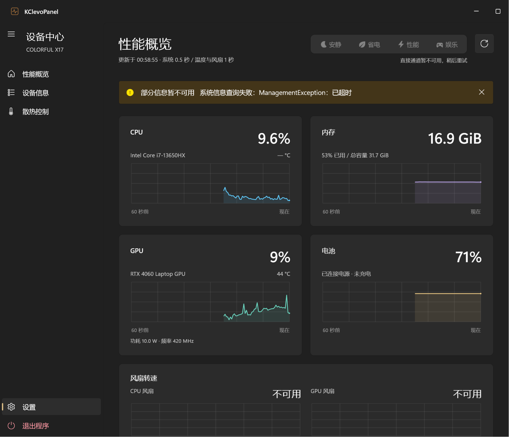
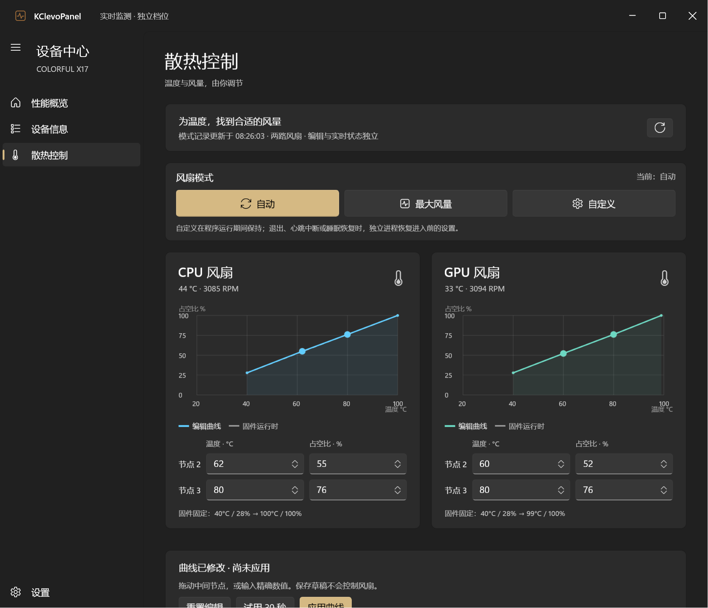
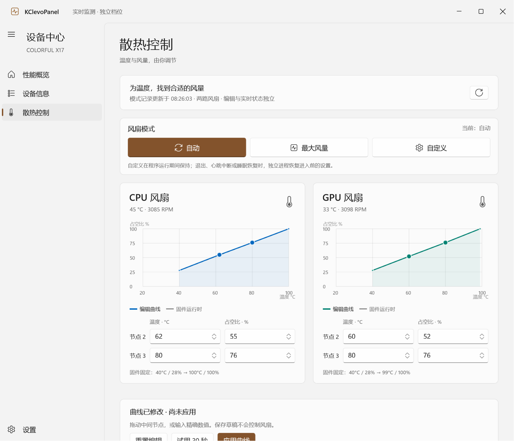
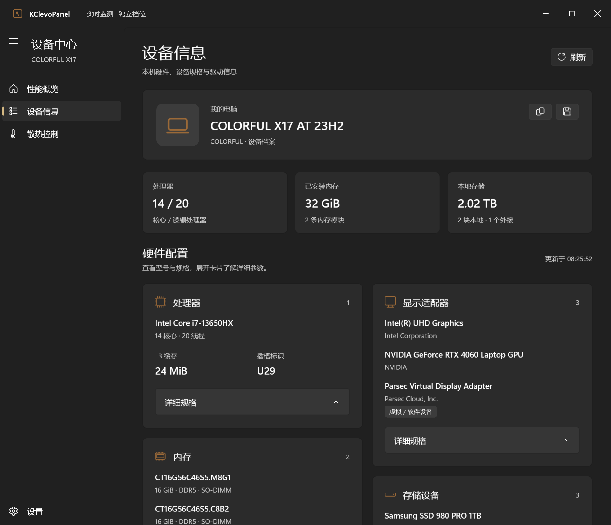
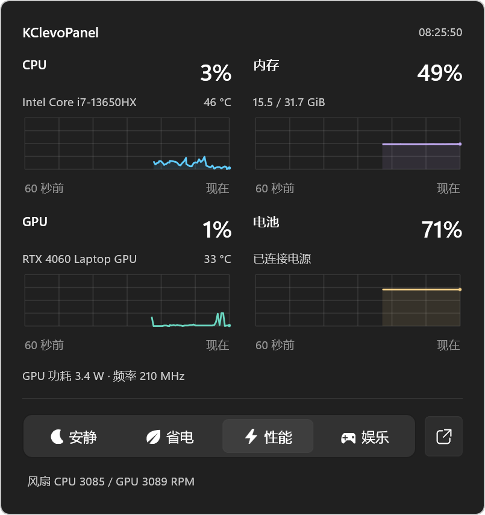

<div align="center">


### 看见每一次负载，调节每一份风量。

为 COLORFUL X17 打造的原生 Windows 设备面板。<br />
实时监测 · 风扇曲线 · 固件档位 · 托盘速览

**WinUI 3** &nbsp; / &nbsp; **.NET 8** &nbsp; / &nbsp; **Windows 11 · x64** &nbsp; / &nbsp; **v0.13**

[界面预览](#界面预览) · [快速开始](#快速开始) · [风扇控制](#风扇控制) · [开发构建](#开发构建) · [验证记录](docs/validation-v0.11.md)

</div>

---

## 一眼掌握设备状态

用熟悉的 Windows 视觉语言，把监测、散热和设备信息放进一个面板。Mica 主窗口、Acrylic 托盘面板、浅色与深色主题，以及按实际时间滚动的网格折线图。

| 实时监测 | 散热控制 | 日常使用 |
| :--- | :--- | :--- |
| CPU、内存、GPU、电池的 60 秒历史 | 自动 / 最大风量 / 自定义 | 点击托盘展开迷你面板 |
| 温度、频率、功耗与双风扇读数 | CPU / GPU 独立曲线编辑 | 最小化和关闭收进托盘 |
| 独立采样频率与平滑绘图 | 拖动节点、精确输入、本机草稿 | 深浅主题、可折叠侧栏 |
| 硬件清单与读取通道诊断 | 30 秒试用、持续应用与恢复 | 安静 / 省电 / 性能 / 娱乐档位 |

## 界面预览



<table>
 <tr>
  <td width="50%"><p align="center"><b>散热控制 · 深色</b></p></td>
  <td width="50%"><p align="center"><b>散热控制 · 浅色</b></p></td>
 </tr>
 <tr>
  <td><p align="center"><b>设备信息</b></p></td>
  <td align="center"><p><b>托盘速览</b></p></td>
 </tr>
</table>

<sub>截图来自 v0.11 实际窗口验证。曲线页展示编辑草稿，不表示正在下发控制；预览使用不透明主题背景，桌面上的 Mica / Acrylic 效果随系统设置变化。</sub>

## 快速开始

1. 获取完整的 Windows x64 发布包，解压到独立目录。
2. 运行 `KClevoPanel.exe`。自包含发布无需另装 .NET 或 Windows App Runtime。
3. 在「性能概览」查看实时状态；在「设置 → 读取通道」核对接口状态。
4. 需要调节时进入「散热控制」。普通读取、编辑和保存草稿不会写风扇。

请保留完整发布目录内的运行库、Assets 和三个工作进程。真正退出请使用托盘右键菜单；关闭主窗口会将其隐藏到托盘。

### 导航与反馈 · v0.13

三个监测页面统一标题区刷新入口，散热页的切换提示与加载状态移至上方。读取通道在设置中以独立页面打开，所有页面加入遵循系统动画偏好的过渡。[更新与验证说明](docs/release-v0.13.md)。

### 设置与关于 · v0.12.1

[更新与验证说明](docs/release-v0.12.1.md)。设置按个性化、启动与后台、数据监测、诊断与应用分组。采样选项共用卡片，诊断默认折叠；窄窗口中控件自动移至说明下方。关于页展示应用标识、真实版本与适配设备，技术致谢折叠收纳，功能卡片随窗口切换单列。

### 启动与后台 · v0.12

在「设置 → 启动与后台」开启**开机自启动**，登录 Windows 后进入托盘。默认关闭，无需管理员权限；不自动应用性能档位或风扇曲线。移动程序目录后请重新开启，系统若禁用启动项可到任务管理器检查。

同一 Windows 用户和会话内只运行一个本版实例。手动重复启动会打开已有窗口；重复的后台自启动静默退出。使用命名互斥量与通知事件，进程异常退出后可重新启动，不按同名进程进行强制结束。旧版程序尚无此保护，请先退出旧版。

加载方面提前建立 CPU 计数基线，设备信息使用最多两路并行查询，并优先显示基础指标。固件身份、驱动与 DLL 校验保持不变；接口首次初始化仍可能需要等待。

### 当前适配

| 项目 | 已验证配置 |
| :--- | :--- |
| 设备 | COLORFUL X17 AT 23H2 |
| 处理器 / 显卡 | Intel Core i7-13650HX / NVIDIA RTX 4060 Laptop GPU |
| 系统 | Windows 11 x64 |
| BIOS | Insyde `1.07.04TCOLO` |
| ACPI 桥驱动 | `CLV0001` · 1.0.0.7 / `CLV0002` · 1.0.40.0 |

**这是针对指定设备的适配项目，目前不声明支持全部 CLEVO / COLORFUL 笔记本。** 控制接口会检查机型、BIOS、驱动和 DLL 身份。需要本机已安装的桥驱动与接口库，但无需原厂客户端进程运行；仓库不包含原厂 DLL，也不安装驱动。

## 风扇控制

两路风扇分别编辑。首尾节点读取自固件并锁定，中间节点保持温度、占空比单调，占空比最低 30%。实线表示编辑曲线，虚线表示固件运行表。

| 操作 | 行为 | 持续时间 |
| :--- | :--- | :--- |
| 自动 | 交由固件调速 | 退出后不主动撤销 |
| 最大风量 | 切换已核对的固件最大模式 | 退出后不主动撤销 |
| 试用 30 秒 | 应用草稿并核对两路节点 | 到期恢复，可转为保持 |
| 应用曲线 / 自定义 | 保持当前曲线 | 本次程序运行期间 |
| 停止并恢复 | 还原进入前的曲线与风扇模式 | 恢复后读回核对 |

自定义写入前会保存基线并启动独立恢复进程。应用退出、心跳超过 10 秒未更新、异常温度 / 转速、采样中断或外部设置覆盖时尝试恢复；睡眠 / 唤醒通知也会请求恢复。收进托盘继续保持，下一次启动不会自动应用草稿。

> **控制边界**：不要同时使用原厂或其他程序改写风扇。恢复进程无法保证在断电、内核挂起等系统故障下执行；恢复未确认时阻止后续控制。真实睡眠 / 唤醒和数小时高负载尚未完成实测。偏移、强冷 / 除尘和开机自动应用暂未开放。

四档按钮仅调整已核对的固件性能档位，尚未复刻原厂预设中的全部 Windows 电源、GPU 和其他联动。协议与限制见[技术说明](docs/technical-notes.md)。

当前版本的[启动与加载验证](docs/release-v0.12.md)包含77项自动检查、跨进程重复启动检查和本次加载计时。

## 验证与本地数据

v0.11 在目标机完成了小幅曲线写入、30 秒到期恢复、最大风量、超过 40 秒持续控制及心跳中断恢复。最大风量时两路占空比达到 100%，转速读数约为 **6956 / 6824 RPM**；测试后原节点与设置 token 均匹配基线。转速使用原厂公式换算，未通过外部仪器校准。

- [实机验证摘要](docs/evidence/v0.11/summary.json)：前后曲线、设置比较与心跳测试结果。
- [76 项自动检查](docs/evidence/v0.11/self-tests.txt)：协议布局、前置条件、故障恢复与生命周期。
- [窗口验证摘要](docs/evidence/v0.11/ui-smoke.json)：界面与托盘检查，风扇及性能写入请求均为 0。
- [完整验证说明](docs/validation-v0.11.md)：修正过程、结果与未验证范围。

设置、曲线草稿和事务记录保存在 `%LOCALAPPDATA%\KClevoPanel`。不联网上传；仅在设置中开启时注册当前用户的登录启动项。普通运行不会自动截图或保存连续遥测。NVIDIA 监测可能唤醒独显，缺失指标显示不可用。

## 开发构建

需要 Windows x64、.NET 8 SDK，以及 NuGet 依赖恢复。`global.json` 指定 SDK 8.0.400，允许通过 `latestFeature` 选择同主次版本的较新 feature band；WinUI 3 与 Windows SDK BuildTools 版本已固定在项目中。

```powershell
# 在仓库根目录构建全部组件
.\build.ps1

# 指定 SDK 与发布目录
.\build.ps1 -Dotnet 'C:\path\to\dotnet.exe' -Destination '.\publish'

# 纯逻辑自动检查，不下发硬件命令
dotnet run --project .\Diagnostics\KClevoPanel.Diagnostics.csproj -- --self-test
```

默认发布到仓库同级的 `KClevoPanel-Windows-x64`，中间产物保存在 `work/build`。可通过环境变量 `X17BuildRoot` 修改中间产物目录。

```powershell
# 在发布目录进行只读诊断
.\KClevoPanel.FanWorker.exe --inspect
.\KClevoPanel.PresetWorker.exe --inspect

# 打开实际窗口，执行禁止控制写入的开发验证并保存预览
.\KClevoPanel.exe --smoke-test C:\absolute\output
```

### 代码导航

```text
App/              WinUI 3 窗口、图表、设置与托盘
Core/             数据模型、曲线协议、事务及进程客户端
TelemetryWorker/  温度与风扇只读采集
PresetWorker/     固件性能档位与事务日志
FanWorker/        风扇模式、曲线及独立恢复进程
Diagnostics/      协议与逻辑自动检查
docs/             预览、技术说明及验证摘要
```

移植到其他机型前，请先核对接口 ABI、命令分支、缓冲区和目标设备条件，建立只读证据，再进行受控验证。请勿通过删除身份检查或猜测命令编号来扩大适配范围。

---

<div align="center">
 <sub>基于 WinUI 3 / Windows App SDK 构建 · 感谢 <a href="https://github.com/jiyeguang25/Clevo-X370-Control-Center">Clevo-X370-Control-Center</a> 提供的研究参考。<br />本项目与 CLEVO、COLORFUL、Microsoft 无隶属或官方背书关系。</sub>
</div>
