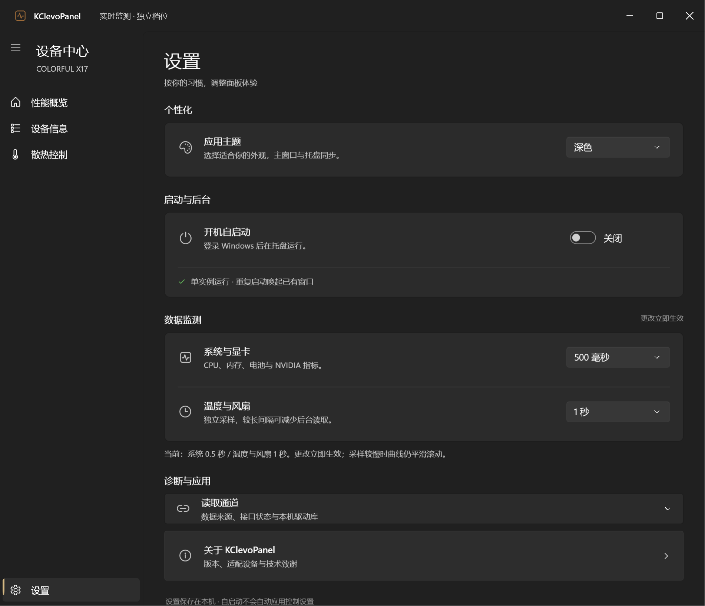
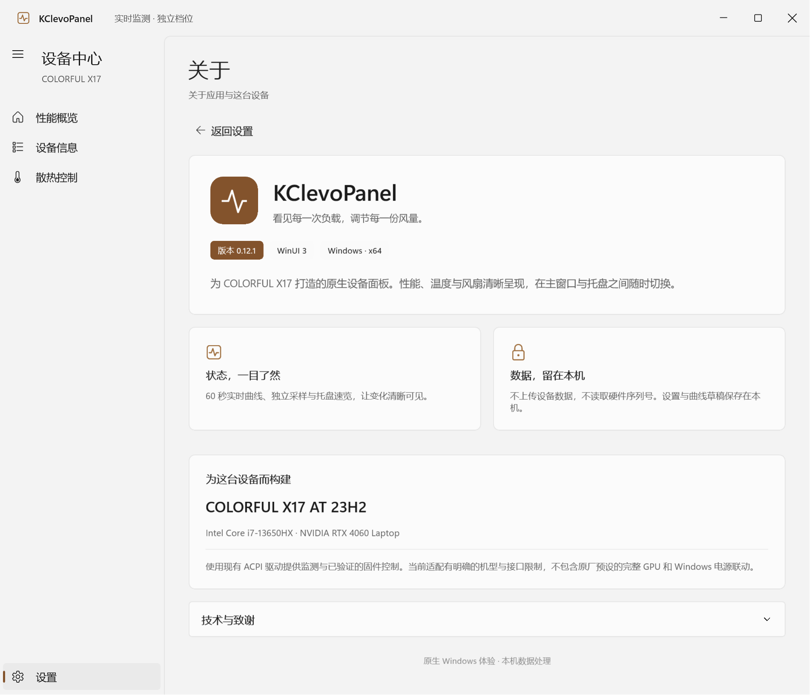

# v0.12.1 · 设置与关于页面

设置页按「个性化、启动与后台、数据监测、诊断与应用」分组，统一图标、说明、卡片间距和控件位置。两种采样间隔合并在同一卡片中；读取通道默认折叠。窄窗口时控件移到说明下方，避免挤压文字。

关于页重做应用标识区、真实版本标签、功能与隐私说明、适配设备卡片；技术致谢默认折叠，提供参考项目链接。双栏功能卡片在窄窗口改为单栏。深浅主题使用WinUI主题资源。

## 验证

- Windows x64 Release构建通过。
- [设置与关于专项验证](evidence/v0.12.1/settings-about.json)通过：深浅主题、页面往返、版本、窄窗口控件边界、关于单列、采样设置生效；风扇和性能控制写入请求均为0。
- 已逐张检查设置/关于的深色、浅色与窄窗口预览。
- [完整回归记录](evidence/v0.12.1/full-regression.json)未通过：在风扇页等待只读曲线加载时停止，尚未到新的设置/关于步骤。因此本版只将上述专项列为通过，没有宣称完整硬件回归通过。未修改控制协议，也未执行硬件写入。

