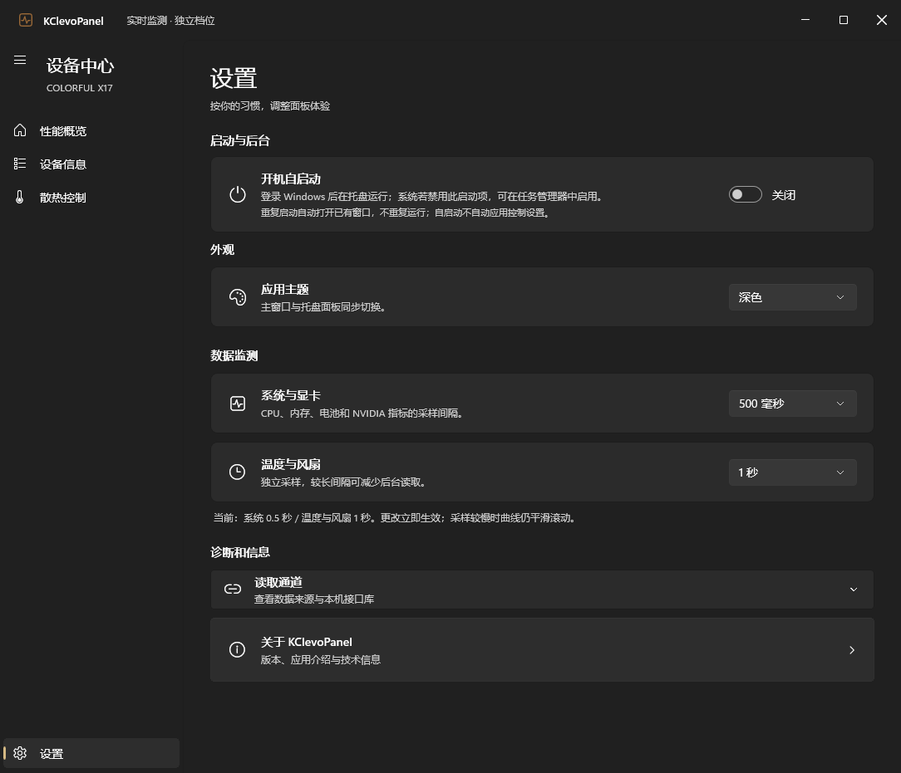

# v0.12 · 启动与加载优化

- 设置新增开机自启动开关，默认关闭。通过当前用户的 Run 注册表项注册完整 EXE 路径及 `--startup`，登录后进入托盘；无需管理员权限。移动目录后需重新开启。操作系统禁用启动项时需在任务管理器检查，开关表示本应用注册状态。
- 同一用户和 Windows 会话使用命名互斥量保证本版单实例，命名事件通知已有窗口。手动重复启动显示已有窗口；后台重复启动静默退出。异常进程退出后系统释放锁。不同安装路径的本版共享锁；此前的0.11及更早版本不使用此协议，升级前需自行退出旧版。
- 监测与控制工作进程仍单独存在，它们不是重复的应用实例；不会按进程名强制终止进程。
- 开机运行不自动切档或应用风扇草稿。此版本未改变风扇控制协议。
- 在XAML初始化前建立CPU计数基线，让首屏即可显示有效使用率；固件档位读取安排在首批基础指标后。设备概要的WMI查询最多两路并行，CPU型号优先使用注册表，缺失时回退WMI。
- 身份、BIOS、桥驱动、DLL哈希及写入前校验不变，不把历史传感器缓存当作实时数值。
- 修正100%缩放时分段按钮像素取整导致选中背景与按钮宽度不同，背景现在跟随所选按钮的实际位置、宽度。

## 验证

77项自动检查通过；完整窗口验证Passed=true，手动和后台两种跨进程重复启动检查通过。设置开关在隔离窗口测试中切换，用户实际启动项保持不变。风扇与性能控制请求均为0。没有执行重启/重新登录验证，也没有为测试开启用户自启动。

本次窗口验证从进程启动计，基础指标与CPU首个有效读数约773ms；GPU从窗口构造计约514ms，温度/风扇约7600ms，设备概要约7428ms。此前0.11历史窗口记录中CPU首个有效读数约1138ms，温度/风扇从窗口构造计约16539ms，设备概要约10781ms；两次负载和显示环境不同，不能作为严格A/B基准或固定提速承诺。基础首屏本次约773ms，历史约590ms，并非所有阶段都变快。冷启动与系统忙碌时仍可能等待数秒完成固件身份查询。

详见[窗口及计时摘要](evidence/v0.12/ui-smoke.json)、[自动检查](evidence/v0.12/self-tests.txt)。

