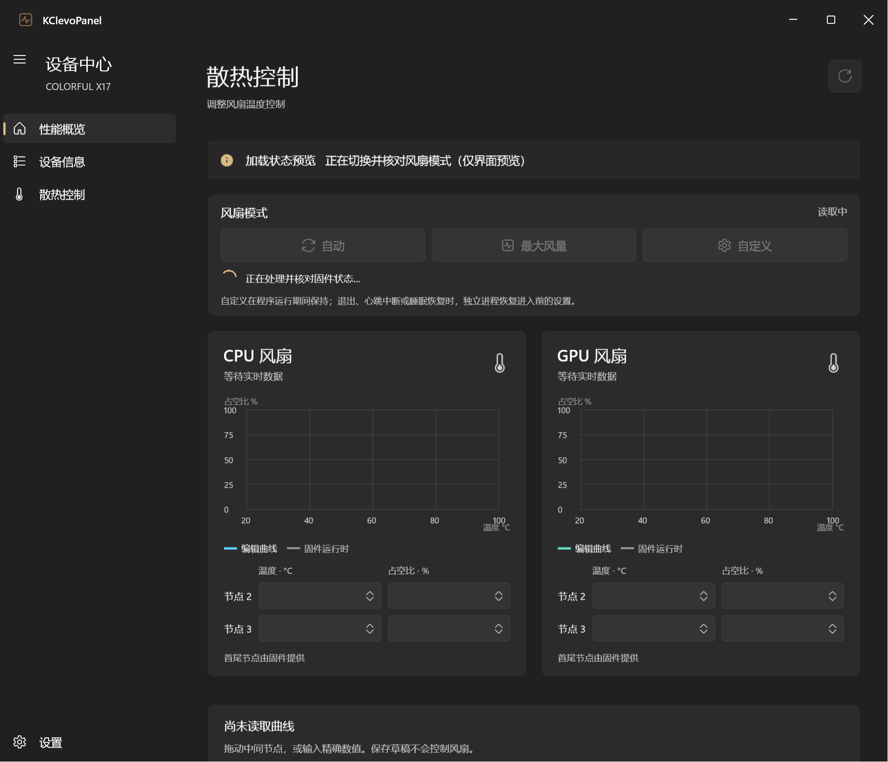
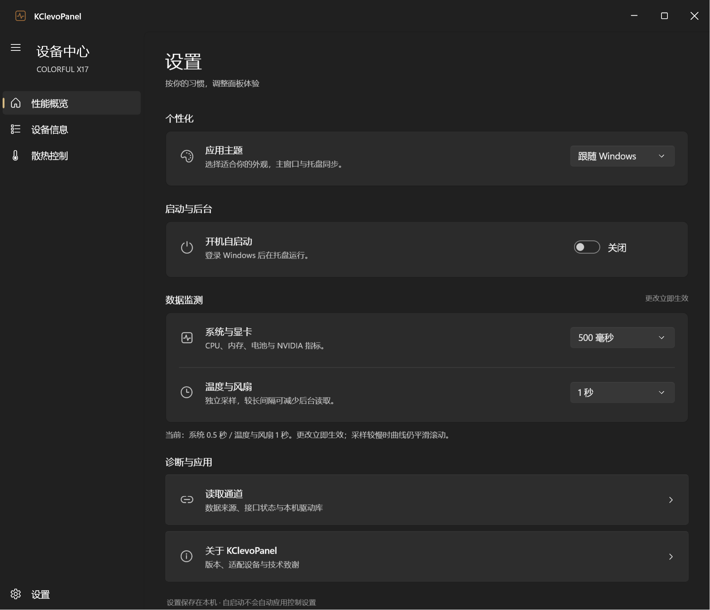

# v0.13 · 导航与控制反馈

1. 标题栏只保留应用名称，移除“实时监测 · 独立档位”。
2. 删除散热控制最上方的信息卡片，刷新操作移至页面标题右侧。
3. 性能概览、设备信息、散热控制共用一个40×40刷新按钮，图标、位置与尺寸一致。窄窗口的性能档位移到标题下一行，避免挤占标题和刷新位置。
4. 散热页副标题改为“调整风扇温度控制”。
5. 风扇切换结果、错误及应用状态提示移到页面最上方。
6. 风扇操作期间显示ProgressRing与处理中提示，禁用重复控制及刷新，读回核对后显示结果；性能档位切换也显示加载指示。不提前显示核对成功。
7. 设置页删除单实例说明行，单实例功能继续生效。
8. 读取通道成为独立页面，设置入口与关于使用同款按钮，提供返回设置入口。
9. 各页面切换加入约200ms淡入与220ms轻微上移，连续切换取消旧动画，结束后还原默认状态。尊重Windows动画开关。

## 验证边界

Release构建通过；[界面专项检查](evidence/v0.13/navigation-feedback.json)通过，包含刷新按钮跨页位置/尺寸、通道导航、风扇加载预览、切换后的透明度与位置。已查看深色页面与浅色窄窗口预览。风扇和性能写入请求均为0，未修改控制协议。

截图中的“加载状态预览”仅验证交互表现，没有发送模式命令。专项在初始接口尚未加载完成时结束，FanTelemetryAvailableAtEnd为false；本轮没有将实机模式切换、固件效果或完整硬件回归列为通过。

